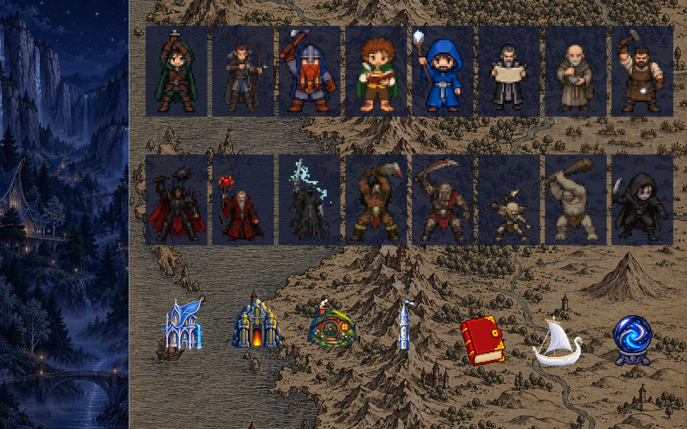

# Twilight Fellowship

A high-fantasy layout for [Herdr](https://herdr.dev), with a matching OpenCode theme. Every agent gets its own pixel-art character from a party of seventeen, nine heroes and eight villains. Spaces become buildings, the sidebar is a starlit valley at night, and terminals sit on an old ink map.



*The preview is put together from the layout's own art, not a screenshot.*

## What you get

- **A character per agent:** each agent draws a character when it starts and keeps it while it runs. Running agents don't share one until all seventeen are taken.
  - **Heroes:** ranger, elven archer, dwarf, halfling, blue wizard, scholar, healer, blacksmith, elven high king.
  - **Villains:** dark lord, fallen sorcerer, wraith, berserker, orc, goblin, cave troll, spy.
- **Animated cards:** every character has three animations. At rest it breathes. When working it swings, draws, casts or hammers. When the agent needs you it raises a hand under a flashing gold `!`.
- **Status words:** "On the road", "Needs you", "Quest done" and "Resting".
- **Tabs:** each tab shows the face of its agent. If a tab has several agents, it shows the one that needs you first.
- **Buildings:** each space gets one of an elven house, a dwarven gate, a round burrow or a white tower.
- **Panel buttons:** a red book for Files, a swan ship for Changes and a seeing stone for Inbox.
- **Herdr theme `twilight-fellowship`:** deep blue, silver frames, star-white text and lamplight gold.
- **OpenCode theme `twilight-fellowship`:** the same colors. Its background is transparent, so the map shows behind OpenCode too.

## Install

Ask your agent inside Herdr:

> Add the layout from https://github.com/rafaremo/herdr-twilight-fellowship. Read RECIPE.md first.

Or by hand, from the repo folder. `cp -n` never overwrites a file you already have:

```sh
H=~/.config/herdr-app
cp -n layouts/twilight-fellowship.* "$H/layouts/"
cp -n themes/twilight-fellowship.json "$H/themes/"
cp -Rn mods/* "$H/mods/"
herdr-app do layout.switch '{"name":"twilight-fellowship"}'
```

If you already have an `inbox` mod, from [Traveler](https://github.com/franky5440-afk/herdr-traveler) for example, `cp -n` keeps yours. They're the same mod.

### OpenCode theme (optional)

```sh
mkdir -p ~/.config/opencode/themes
cp opencode/themes/twilight-fellowship.json ~/.config/opencode/themes/
```

In OpenCode, run `/reload`, then pick **twilight-fellowship** with `/themes`. You can also set it in `~/.config/opencode/cli.json`:

```json
{ "theme": { "name": "twilight-fellowship", "mode": "dark" } }
```

The theme only has a dark mode. It changes OpenCode's look in every terminal, not just in Herdr.

## Customize

- **Buildings:** edit `mods/twilight-fellowship-spaces/places.json`, for example `{"api": "gate"}`. The options are `valley`, `gate`, `burrow` and `tower`. A space that isn't listed gets a fixed pick based on its name.
- **Map visibility:** `terminal_opacity` in `layouts/twilight-fellowship.json` is set to `0.45`. Higher makes text easier to read, lower shows more of the map.
- **New art:** the prompts are in [docs/ART-PROMPTS.md](docs/ART-PROMPTS.md). `scripts/build-art.py` turns generated sheets into the sprites and icons (Python 3 with Pillow).

## HP and SP (optional, Claude Code)

The agent cards read the same status-line data as Traveler. Install [Traveler's status line script](https://github.com/franky5440-afk/herdr-traveler#hp-and-sp-optional-claude-code) to get HP (remaining context) and SP (remaining 5-hour quota) on Claude Code cards. Without it they show `—`.

## What it does on your machine

- `twilight-fellowship-spaces` runs `git status` and `git rev-parse` in the folders your terminals are in, and `hc machine ls`. On connected remote machines, Herdr runs that `git` there.
- `inbox` runs `mkdir`, `find`, `stat` and `open` (macOS) on `~/.config/herdr-app/data/inbox/files`.
- `twilight-fellowship-agents` reads `~/.config/herdr-app/data/traveler/sessions/*.json` if that folder exists.
- No mod opens a network connection or reads credentials.
- Don't open a terminal inside a repo you don't trust: `git status` can run filters from that repo's own `.git/config`.

## Uninstall

```sh
H=~/.config/herdr-app
herdr-app do layout.switch '{"name":"main"}'
rm -rf "$H"/mods/twilight-fellowship-* "$H"/data/twilight-fellowship-*
rm -f "$H"/layouts/twilight-fellowship.* "$H"/layouts/.state/twilight-fellowship.json "$H"/themes/twilight-fellowship.json
rm -f ~/.config/opencode/themes/twilight-fellowship.json
```

Remove `mods/inbox` too if nothing else uses it.

## License and art

Code is Apache 2.0, see [LICENSE](LICENSE) and [NOTICE](NOTICE). The mods are modified copies of [Traveler](https://github.com/franky5440-afk/herdr-traveler)'s, which are modified copies of Herdr's built-in mods.

The images are AI-generated and are **not** covered by the Apache license. See [ART-NOTICE.md](ART-NOTICE.md). The characters and places are original designs. This project isn't affiliated with Herdr, OpenCode, or any author, estate, publisher or studio.
