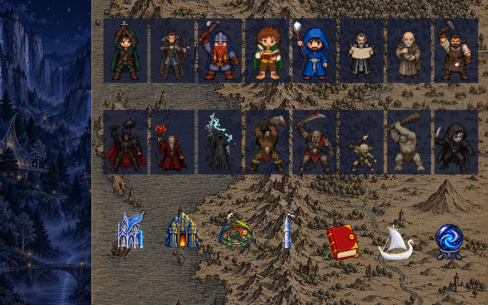

# Twilight Fellowship

A high-fantasy layout for Herdr at night. Each agent is a party member with its own animated pixel character, eight heroes and eight villains. Each space is a building, the sidebar is a starlit valley, and terminals sit on an old ink map. A matching OpenCode theme lets the map show behind OpenCode too.

**What you see:**

- **Theme `twilight-fellowship`:**
  - deep blue `#0b1124` background and `#121a33` panels
  - silver accent `#c8d3e8` and borders `#c8d3e866`
  - star-white text `#e4e8f2`
  - lamplight gold `#e3c27a` for `solid` and the cursor
  - status colors: blocked `#e3a04f`, working `#7fa8e0`, done `#8fc4a0`
  - square corners
- **Terminals** sit on an ink map: the tab block's pane `background` is `mods/twilight-fellowship-chrome/fellowship-map.png` (`cover`), and root `terminal_opacity` is `0.45`.
- **Left sidebar, 268px:** one painted valley at night from top to bottom (`fellowship-sidebar.png`, `cover`). A 46px header says "Twilight Fellowship"; the footer is 69px.
- **Spaces, top half of the sidebar:** a 76px row per space with a 72px building, the name, and up to three git lines (uncommitted files, unpushed commits, repos without a remote). The active row has a silver frame on `surface` at `c8` alpha.
- **Agents, bottom half:** one framed card per agent. Each card has:
  - a 72×96 animated full-body character
  - the tab name and a status word
  - a program tag (`Claude` in `accent`; `Codex`/`OpenCode` in `unknown`)
  - HP and SP bars for Claude
- **Tab bar, 58px:** square 48px tabs with a 44px face, plus Files (red book), Changes (swan ship) and Inbox (seeing stone) buttons, each 20px.
- **Main area:** panes with 1px `#c8d3e899` borders and an `accent` border on the focused pane; gap 8px, radius 0.

**How it behaves:**

- **Status words:** working "On the road" (blue), blocked "Needs you" (orange, card frame orange too), done "Quest done" (green), idle "Resting" (dim).
- **Sprites:**
  - *working:* alternates two poses, 320 and 260 ms
  - *blocked:* raises a hand under a gold `!` that flashes every 320 ms
  - *done, idle, no status:* the resting pose, which breathes (the upper body sinks one pixel for 600 ms every 1.5 s)
- **Characters are per agent:** a new agent gets a character the first time the agents list sees it. It keeps that character while it lives. Live agents don't share one until all sixteen are used.
- **Tab faces:** a tab shows its agent's face, preferring blocked, then done, then working. A tab without an agent shows its program icon.
- **Clicks and drags:** clicking a card focuses that agent. Clicking a space selects it, right-click opens its menu, and dragging reorders it within a machine. Tabs and panel buttons work like the shipped ones, and the open panel is remembered per space.

**Built from:**

- **Layout:** `layouts/twilight-fellowship.json`, cloned from Traveler (itself a clone of Herdr's `main`). Node tree:
  - row `root`
  - column `sidebar`: block `brand`, column `sidebar-lists` (blocks `spaces`, `agents`), block `sidebar-footer`
  - column `work`: block `tabs`, row `work-body` (`main`, and the hidden `panel` stack `panel-body` with `files`, `changes`, `inbox`), block `status`
- **`twilight-fellowship-agents`:**
  - `lib.js` holds `JOBS` (8 heroes, then 8 villains) and `assignParty(addresses, party)`.
  - `render` calls `assignParty(agents().map(a => a.address), shared(PARTY_KEY))` and writes back with `setShared` only when something changed. `PARTY_KEY` is `"twilight-fellowship.party"`.
  - The record forgets dead agents once it holds more than 32.
  - It reads HP/SP from `data/traveler/sessions/<id>.json` (Traveler's status line format).
- **`twilight-fellowship-tabs`:** reads the same shared key; `lib.js` is a copy of the agents one.
- **`twilight-fellowship-spaces`:** buildings `valley`, `gate`, `burrow`, `tower` from `places.json` or a fixed pick by name. It runs `git` and `hc machine ls`.
- **`twilight-fellowship-chrome`:** the header and footer; translucent fills over the sidebar art.
- **`inbox`:** Traveler's, unchanged.
- **Shipped mods used:** `pane`, `files`, `changes`, `workspace-status`, `menu`, `new-menu`, `picker`.
- **Art:** 16 characters × 3 GIFs (144×192: 36×48 pixels at 4×) plus 16 portraits, 4 buildings, 3 icons and 2 backgrounds. All of it is built from generated images by `scripts/build-art.py`; prompts are in `docs/ART-PROMPTS.md`.
- **OpenCode:** `opencode/themes/twilight-fellowship.json` is a V2 theme derived from OpenCode's default:
  - `background.base` is `transparent`
  - raised surfaces are `#121a33`, `#1a2340` and `#26304f`
  - a twilight gray scale, a silver `blue`/`interactive` scale and a gold `yellow`/`accent` scale

**Watch out:**

- **Image caching:** Herdr caches images by path. Art replaced under the same filename keeps showing the old picture until restart, so use new names when iterating. A missing path is remembered too: put art in place before code references it.
- **Lists stay in sync:** `lib.js` exists twice (agents and tabs), and both `JOBS` lists must match the files in `party-sprites/` and `party-art/`.
- **Existing assignments stick:** characters are kept in shared state, so after changing `JOBS`, running agents keep their old pick until they end.
- **OpenCode's background:** an OpenCode theme with a solid background hides the map. The `system` theme draws solid boxes from the terminal background. That's why the custom theme exists.
- **New theme files need a reload:** OpenCode only finds a new theme file after `/reload` or a restart; `cli.json` itself reloads live.
- **Sheets that don't follow the prompt:** generated sheets sometimes ignore the green background or let figures touch. `build-art.py` thresholds alpha at 128 and cuts touching figures at their thinnest column.
- **Readability:** text over the busiest parts of the map gets harder to read below `terminal_opacity` 0.4.

**Done when:**

- `herdr-app check` passes for every mod in `mods/`, and `herdr-app status` shows no errors after `layout.switch {"name":"twilight-fellowship"}`.
- Two agents in tabs with the same name show different characters, and a third agent gets a third one without changing the first two.
- A working agent's card animates its working poses, and a blocked one shows the flashing `!`.
- Each space shows a building; Files, Changes and Inbox show the book, ship and seeing stone.
- With the OpenCode theme selected, the map is visible behind OpenCode's transcript and its boxes are `#121a33`.
